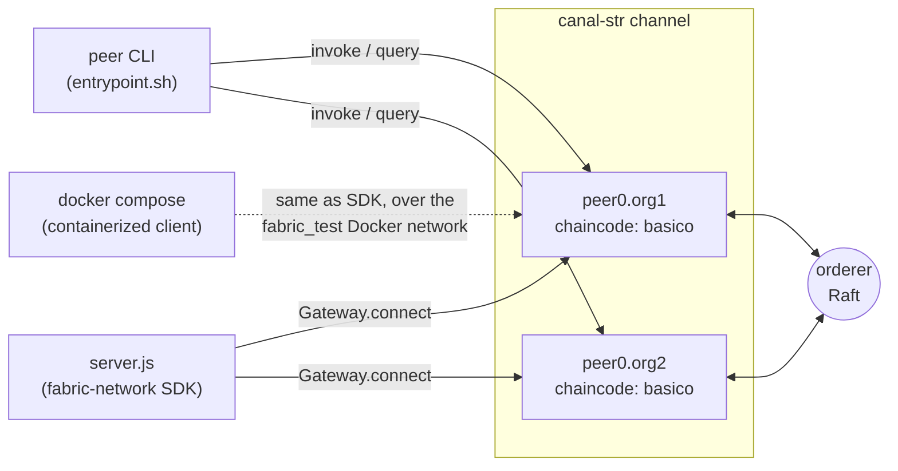

# Central Bank Settlement Chain

[](https://github.com/oniforo/central-bank-settlement-chain/actions/workflows/test.yml)
[](https://github.com/oniforo/central-bank-settlement-chain/actions/workflows/live-network.yml)
[](https://github.com/oniforo/central-bank-settlement-chain/releases/latest)
[](https://github.com/oniforo/central-bank-settlement-chain/blob/main/LICENSE)

A two-organization Hyperledger Fabric channel modeling a Central Bank fund
transfer, deployed to a live network and run end-to-end - continuously
re-verified by CI on every change.

> **Sistema de Transferência de Fundos: Adoção de uma Infraestrutura
> Descentralizada pelo Banco Central** ("Fund Transfer System: Adoption of a
> Decentralized Infrastructure by the Central Bank") - bachelor's thesis by
> Gabriel Orofino, Centro Universitário Ibmec/RJ, 2022 (advisor: Prof. Me.
> Victor Machado da Silva). This repository holds its proof-of-concept code.

**The proof of concept works.** The thesis's central goal was to attest the
viability of this approach ("atestar a viabilidade"), and that's now been
verified for real, not just written up: the two-organization Fabric channel
described in section 3.6 has been deployed to a live Hyperledger Fabric
network and run end to end - `InitLedger` seeding the ledger, `TransferAsset`
moving value between two economic agents, `GetAllAssets` reflecting the
result - through all three ways this repo can be used (the native `peer`
CLI, the `fabric-network` SDK client, and the containerized client). This
validates the two-organization model the thesis proposes, not production
RTGS scale or throughput - see **Simplifying hypothesis** and **Future
work** for what's deliberately out of scope. See **Known gaps** for the
handful of real bugs that verification caught and fixed along the way.

**What "works" actually looks like:**

```
TransferAsset("asset5", "Michel", "100") response:
{"from":"Adriana","to":"Michel","value":"100","debitId":"<txID>-debit","creditId":"<txID>-credit"}
```

The ledger goes from 6 entries after `InitLedger` to 8 after the transfer -
a `+100` credit for Michel, a `-100` debit for Adriana - asserted verbatim
on every push in
[live-network.yml](.github/workflows/live-network.yml#L88-L93), not just
claimed here.

The code exactly as submitted for the thesis is preserved at the
[`v1.0.0` release](https://github.com/oniforo/central-bank-settlement-chain/releases/tag/v1.0.0).
This document and the code have since been updated beyond that snapshot -
see **Known gaps** for what's changed and why.

## Contents

- [Context](#context)
- [What's in this repo](#whats-in-this-repo)
- [Architecture](#architecture)
- [Running the PoC](#running-the-poc)
- [Running the client app](#running-the-client-app)
- [Running tests](#running-tests)
- [Simplifying hypothesis](#simplifying-hypothesis-from-the-thesis)
- [Known gaps](#known-gaps)
- [Future work](#future-work-from-the-thesiss-closing-remarks)
- [Reference](#reference)

## Context

Brazil's Reserve Transfer System (**STR** - *Sistema de Transferência de
Reservas*), operated by the Central Bank of Brazil (BCB), settles the
country's financial obligations via real-time gross settlement (RTGS). The
thesis reviews the literature on central banks adopting blockchain / DLT
infrastructure, and argues that a private/permissioned blockchain could
improve auditability, reduce intermediaries, and increase settlement
efficiency and transparency - while acknowledging real barriers: legacy
system replacement costs, irrevocability of transactions, and skepticism
that DLT settlement can match current RTGS speed.

To test the idea at a small scale, the thesis builds a proof of concept
using **Hyperledger Fabric** that models a simplified two-organization STR
channel and demonstrates a fund transfer between two economic agents. This
codebase is the practical artifact described in section 3.6 ("Proposta de
Implementação").

## What's in this repo

- [chaincode/](chaincode/) - the deployable chaincode package:
  - [chaincode/functions.js](chaincode/functions.js) - the `AssetTransfer`
    contract (Fabric Contract API), based on the thesis's Figure 14
    ("Código Javascript modificado"), with the bugs described in the thesis
    fixed (see **Known gaps**):
    - `InitLedger` - seeds the ledger with six sample assets/balances
    - `AssetExists(id)` / `ReadAsset(id)` - existence check and read, used
      by the two methods below
    - `CreateAsset(id, owner, appraisedValue)` - creates a new ledger entry
    - `TransferAsset(id, newOwner, value)` - represents a transfer as a
      debit entry and a credit entry (see **Simplifying hypothesis** below)
    - `GetAllAssets` - returns every entry currently on the ledger
  - [chaincode/index.js](chaincode/index.js) / [chaincode/package.json](chaincode/package.json) -
    the entry point and self-contained manifest Fabric's chaincode packaging
    actually builds from (`peer lifecycle chaincode package` needs the
    chaincode directory to be a standalone Node package - see **Known gaps**
    for why this lives in its own subdirectory rather than at the repo root)
- [server.js](server.js) - a `fabric-network` SDK client that imports the
  existing `Admin@org1.example.com` identity (from `entrypoint.sh`'s static
  cryptogen-generated MSP material) into a local wallet, connects to the
  `canal-str` channel, and runs a demo sequence against the `basico`
  chaincode (`InitLedger`, `GetAllAssets`, a `TransferAsset` call,
  `GetAllAssets` again)
- [entrypoint.sh](entrypoint.sh) - the exact command sequence from section
  3.6: installs Hyperledger Fabric, brings up the `test-network` sample,
  creates the `canal-str` channel, deploys chaincode from `chaincode/` (this
  repo's own source, not a `fabric-samples` sample - see **Known gaps**),
  and invokes/queries a transfer between two of the seeded accounts
- [Dockerfile](Dockerfile) / [docker-compose.yml](docker-compose.yml) -
  containerizes `server.js` and attaches it to the Fabric test-network's
  Docker network so it can reach the running peers (see **Running the
  client app**)
- [package.json](package.json) / [yarn.lock](yarn.lock) - Node manifest for
  the client (`fabric-network`) and test tooling (Mocha/Chai/Sinon/nyc).
  Also declares the chaincode's runtime dependencies
  (`fabric-contract-api`, `json-stringify-deterministic`,
  `sort-keys-recursive`) so `require('../chaincode/functions.js')` resolves
  locally for tests via Node's upward `node_modules` lookup - the actual
  deployed chaincode package resolves its own copies from
  `chaincode/package.json` instead, since Fabric's build step only sees the
  `chaincode/` directory in isolation
- [test/functions.test.js](test/functions.test.js) - Mocha/Chai/Sinon unit
  tests for `chaincode/functions.js`, run automatically on every push/PR
  (see [.github/workflows/test.yml](.github/workflows/test.yml))

## Architecture

Two organizations, one channel, one chaincode - `entrypoint.sh` stands this
up from Fabric's `test-network` sample, and all three client paths below
talk to the same running network:



`basico` is the chaincode ID `entrypoint.sh` deploys `chaincode/` under -
see **What's in this repo** above for what each piece actually does, and
**Running the PoC**/**Running the client app** below for how to drive each
of the three paths.

## Running the PoC

Prerequisites: Docker, `curl`, Node.js 20 + Yarn, and a Linux-like shell
(the thesis used Ubuntu 20.04 LTS on a Linode instance).

```bash
yarn install
```

Then follow [entrypoint.sh](entrypoint.sh) - it installs Fabric's samples,
binaries and Docker images, stands up `test-network`, creates the
`canal-str` channel, deploys chaincode `basico`, and runs `InitLedger`,
`GetAllAssets`, and a `TransferAsset` invocation via the native `peer`
CLI. It is a reference/runbook script (as in the thesis), not meant to be
executed unattended.

**On Windows**, don't run this in Git Bash - Fabric's native Windows
binaries and its Docker-heavy scripts need conflicting path-translation
behavior from Git Bash/MSYS, in ways that fail unpredictably partway
through. Use WSL2 with a real Linux distro instead; see
[docs/windows-wsl2-fabric-notes.md](docs/windows-wsl2-fabric-notes.md) for
what was actually hit trying this (including a WSL2 distro that wouldn't
start at all, and a Docker Engine version floor) and how to get a working
setup.

## Running the client app

Once the test network is up and chaincode `basico` is deployed (i.e. after
running through `entrypoint.sh`), the same demo sequence can be run through
the `fabric-network` SDK instead of the native `peer` CLI:

**Bare host:**

```bash
yarn install
yarn start
```

`server.js` looks for the test-network's connection profile under
`TEST_NETWORK_HOME` (defaults to `~/src/fabric/fabric-samples/test-network`,
the same path `entrypoint.sh` uses) and, on first run, imports the
`Admin@org1.example.com` identity from `entrypoint.sh`'s own cryptogen-
generated MSP material into a local filesystem wallet (`wallet/`,
gitignored) - the same identity the native `peer` CLI commands already use
via `CORE_PEER_MSPCONFIGPATH`. `entrypoint.sh` brings the network up without
`-ca`, so there's no running Fabric CA server to enroll against.

Note: for the SDK's discovery service to find endorsing peers across both
orgs (used by `gateway.connect`'s `discovery: { enabled: true }`), the
channel's anchor peers must be set for both orgs - this happens at the end
of `createChannel.sh`'s flow, so if that script exits early for any reason
(see [docs/windows-wsl2-fabric-notes.md](docs/windows-wsl2-fabric-notes.md)
for one way it can), `server.js` will fail with a discovery error even
though the native `peer` CLI still works fine against the same network.

**Containerized:**

```bash
export TEST_NETWORK_HOME=~/src/fabric/fabric-samples/test-network
docker compose up --build
```

This attaches the client container to the `fabric_test` Docker network that
Fabric's `test-network` already creates, mounting the host's generated
crypto material read-only and reaching peers by their container DNS names
instead of `localhost`.

## Running tests

The chaincode logic (`chaincode/functions.js`) has a unit test suite that
mocks `ctx.stub` in-memory, so it runs standalone without a live Fabric
network:

```bash
yarn install
yarn test
```

This runs Mocha under `nyc` for coverage reporting. `server.js` isn't
covered by these unit tests - it's a thin SDK wrapper whose behavior only
means anything against a live network. It's covered instead by a separate
CI workflow, [.github/workflows/live-network.yml](.github/workflows/live-network.yml),
which runs on every push/PR alongside the unit tests: installs Fabric,
brings up a real test network, deploys this repo's chaincode, and asserts
on the actual `InitLedger`/`TransferAsset`/`GetAllAssets` output through
all three paths (native `peer` CLI, the SDK client, and the containerized
client) - the same verification described in **Context** above, now
re-run automatically instead of only having been done once by hand. Both
workflows are required status checks on `main` - neither can be merged
past while red.

## Simplifying hypothesis (from the thesis)

The proof of concept adopts one simplification, stated explicitly in
section 3.6: the ledger entries produced by `InitLedger` represent each
client's **total balance**, not individual transactions. A transfer is
modeled as two new `CreateAsset` calls - a debit for the sender and a
credit for the recipient - rather than mutating the sender/recipient's
existing balance in place.

## Known gaps

The following describes the thesis submission's code ipsis literis; every
item below has since been fixed, and is kept as a record of what was
actually wrong. The first bullet turned out to be worse than it first
looked: the thesis's code didn't just return the wrong value, it called
methods that didn't exist and could never have run at all.

<details>
<summary><strong>7 bugs found and fixed since the thesis submission (click to expand)</strong></summary>

- ~~`TransferAsset` returns an undefined variable~~ **and, more seriously,
  called two methods that didn't exist.** `CreateAsset` called
  `this.AssetExists(...)` and `TransferAsset` called `this.ReadAsset(...)`,
  but neither method was defined anywhere in the class - so both threw a
  `TypeError` immediately, before any ledger write happened (only
  `InitLedger`/`GetAllAssets` worked, since they're the only two methods
  that didn't depend on the missing helpers). Fixed by adding the standard
  `AssetExists`/`ReadAsset` implementations and correcting `TransferAsset`'s
  return value.
- ~~The two debit/credit entry IDs are hardcoded~~, which meant a second
  `TransferAsset` call would fail with "asset already exists." Fixed by
  deriving both IDs from `ctx.stub.getTxID()` - the transaction ID, which is
  the standard source of a value every endorsing peer computes identically
  (chaincode must stay deterministic; `Date.now()`/`Math.random()`/
  `crypto.randomUUID()` would diverge across peers and fail endorsement).
- ~~`package.json` declared `"main": "server.js"` with no such file~~ -
  `server.js` now exists (see **What's in this repo**).
- ~~`Dockerfile`/`docker-compose.yml` were empty~~ - now containerize the
  client app (see **Running the client app**).
- ~~`chaincode/package.json` had no `"start"` script or `fabric-shim`
  dependency~~ - discovered by actually deploying it: the chaincode
  container built and installed fine, then crashed immediately
  (`npm error Missing script: "start"`). `fabric-contract-api` alone only
  provides the contract framework; `fabric-shim` (via its
  `fabric-chaincode-node` CLI) is the runtime that actually starts the
  chaincode server. Fixed by adding both.
- ~~`server.js` assumed a Fabric CA-based enrollment flow~~ - discovered the
  same way: it failed trying to reach a CA that was never started, since
  `entrypoint.sh` brings the network up without `-ca`. Fixed by importing
  the existing cryptogen-generated `Admin@org1.example.com` identity
  directly instead, which also let `fabric-ca-client` be dropped from
  `package.json` entirely (see **Running the client app**).
- ~~The containerized client couldn't reach the peers~~ - `AS_LOCALHOST=false`
  only affects addresses the *discovery service* returns; the connection
  profile's own peer/CA `url` fields are hardcoded to `localhost` (generated
  for host-based clients) and are used as-is for the initial bootstrap
  connection. From inside a container that's not reachable. Fixed by
  rewriting those URLs to each entry's real hostname
  (`grpcOptions['ssl-target-name-override']`) when not running as localhost.
- ~~`entrypoint.sh` deployed chaincode from
  `../asset-transfer-basic/chaincode-javascript`~~ - a path inside
  `fabric-samples`, not from this repo, so `functions.js` was never actually
  the file that got deployed; it was illustrative only. Fixed by moving the
  contract into its own [chaincode/](chaincode/) subdirectory (with its own
  `package.json`/`index.js` - Fabric's chaincode packaging needs a
  standalone Node package, since `peer lifecycle chaincode package` only
  sees the directory passed via `-ccp`, nothing outside it) and pointing
  `entrypoint.sh`'s `deployCC` at that directory via an absolute path
  computed from the script's own location.

</details>

**Known, accepted security risk**: `jsrsasign` (used by `fabric-common` for
certificate/crypto handling) has several open CVEs, including one critical.
`fabric-common` pins `"jsrsasign": "^10.5.25"` - and that's true even at the
latest stable `fabric-common` release (`2.2.20`; nothing newer exists except
unstable `2.5.0-snapshot.*` pre-releases) - which caps resolution below the
`>=11.0.0` the fixes need. This can't be closed by any `package.json`
version bump on this repo's side; it's an upstream Hyperledger Fabric SDK
limitation. A `yarn` `resolutions` override could force a newer `jsrsasign`,
but that would be a semver-major jump underneath a crypto/signing library
that `fabric-common` doesn't declare as compatible - risking silent
breakage in identity enrollment/signing that would only surface at runtime.
Left as-is and tracked rather than forced.

## Future work (from the thesis's closing remarks)

The thesis's "Considerações Finais" suggests these extensions:

- Deepen Fabric's configuration options to reflect real sectors of the
  Brazilian National Financial System, building on the two-participant
  channel shown here.
- Generalize the channel from two participants to **n agents**, each with
  different read/write permissions on the shared ledger.
- Introduce **anchor nodes operated by the Central Bank** to guarantee
  stability and redundancy of operations on the network.

## Reference

Orofino, G. L. *Sistema de Transferência de Fundos: adoção de uma
infraestrutura descentralizada pelo Banco Central*. Trabalho de Conclusão
de Curso (Graduação em Ciências Econômicas) - Centro Universitário Ibmec,
Rio de Janeiro, 2022.
